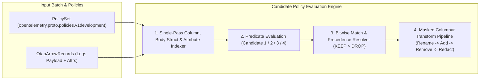

# Pure-Rust Columnar Telemetry Policy Evaluation Engine for OTAP (`open-telemetry/otel-arrow#4726`)

## 1. Executive Summary & Recommendation

`open-telemetry/otel-arrow#4726` (and companion processor issue `open-telemetry/otel-arrow#4718`) proposes adding a telemetry policy processor to the Rust OTAP Dataflow Engine (`rust/otap-dataflow`) aligned with the OpenTelemetry Telemetry Policy specification (`open-telemetry/opentelemetry-proto#865` / OTEP 4738). While `opentelemetry.proto.policies.v1development` defines four policy message types (`LogFilterPolicy`, `LogTransformPolicy`, `MetricFilterPolicy`, and `TraceSamplingPolicy`), this prototype scopes its M1-M3 runtime evaluation and benchmarks to **Logs (`LogFilterPolicy` and `LogTransformPolicy`)** while defining the complete 4-policy protobuf data model.

An active 14-commit WIP branch (`albertlockett/otel-arrow:albert/4718-policy-engine`) currently prototypes `#4718` by wrapping `usetero/policy-rs` (`v1.8.2`) and its C/C++ Vectorscan dependency (`vectorscan-rs-sys`). Our code audit of `albert/4718-policy-engine` and `policy-rs` identified six architectural, specification, and correctness gaps that make a clean, pure-Rust columnar engine both necessary and substantially faster on realistic OTAP workloads:

1. **C/C++ Build Dependency (`vectorscan-rs-sys`)**: `policy-rs` compiles C/C++ Vectorscan from source via `cmake` and pulls in duplicate versions of `prost` (`0.13.5` vs. `0.14.4`), `tonic` (`0.12` vs. `0.14`), and `notify` (`7.0` vs. `8.2`).
2. **Legacy Schema (`tero.policy.v1`) vs. Official OTel Policy Spec (`opentelemetry.proto.policies.v1development`)**: `policy-rs` uses Tero's legacy `LogTarget` proto rather than the 4 policy types (`LogFilterPolicy`, `LogTransformPolicy`, `MetricFilterPolicy`, `TraceSamplingPolicy`) and unified 8-variant `Predicate` (`exists`, `equals`, `regex`, `gt`, `gte`, `lt`, `lte`, `contains`) in `opentelemetry-proto#865`.
3. **Inverted Filter Precedence (`keep` vs. `drop`)**: In `opentelemetry-proto#865` (`experimental-docs/specifications/policy.md:730-739`), **`ACTION_KEEP` overrides `ACTION_DROP`** (keep acts as an exemption over drop). In `albert/4718-policy-engine` (`src/engine/mod.rs:235-331`), following legacy `policy-rs`, `keep: "none"` (drop) overrides `keep: "all"` (keep), and `keep: "all"` is ignored when computing drop masks.
4. **Transform Stage Ordering, Unimplemented Ops & Batch-Splitting Overhead**: `opentelemetry-proto#865` (`policy.md:431-440`) requires executing transform stages globally in order **`1. Rename -> 2. Add -> 3. Remove -> 4. Redact`** (ordered by ascending `Policy.id` within each stage). `albert/4718-policy-engine` orders operations per policy as `Remove -> Redact -> Rename -> Add`, leaves `TransformOp::Redact` and `TransformOp::Add` as unimplemented `// TODO` no-ops (`src/engine/transform.rs:46-56`), Ignore `upsert: false` on `Rename`, and splits/re-concatenates the Arrow batch (`filter_otap_batch` + `otel_arrow_dfe_pdata::otap::transform::concatenate::concatenate`) on every partially-matching transform policy (`src/engine/mod.rs:147-212`, `src/engine/transform.rs:204-218`).
5. **Silent `logs.body` No-Op & `Int32` Coercion Panic in `albert/4718-policy-engine`**: In `OtapArrowRecords` (`crates/pdata/src/schema/payloads.rs:315-410`), `logs.body` is a `StructArray` (`BODY_SCHEMA`: `type`, `str`, `int`, `double`, `bool`, `bytes`, `ser`) and `severity_number` is `Int32` or `Dict<UInt8, Int32>`. In `albert/4718-policy-engine`, `evaluate_vectorscan_on_root_column` (`src/engine/evaluate.rs:668-683`) passes `root_batch.column_by_name("body")` directly to `StringColumnAccessor::try_new`, which returns `None` on a `StructArray` and silently marks all `body` policies `None` in $O(1)$ without scanning! Likewise, `evaluate_numberic_cmp` (`src/engine/evaluate.rs:171-206`) only handles `Int64Array`/`Float64Array` and panics with `todo!("numberic coercion")` on `Int32` `severity_number`.
6. **Columnar & Vectorscan Evaluation Bottlenecks**: `policy-rs` compiles exact string matches (`Exact("DEBUG")`) into Vectorscan regex databases (`^DEBUG$`, `src/engine/compiled.rs:812-888`), clones and frees Vectorscan scratch space (`hs_clone_scratch` / `hs_free_scratch`) on every single string scan (`src/engine/compiled.rs:295-348`), scans the `LogAttrs` `key` column separately for each watched attribute key ($O(K \times N_{\text{attrs}})$ in `src/engine/evaluate.rs:715-852`), and allocates a `HashMap<usize, Vec<u32>>` entry per row when scanning non-dictionary `StringArray` columns (`src/engine/evaluate.rs:957-971`).

**Recommendation**: Build and benchmark **4 pure-Rust candidate engines** against **2 baselines** (`policy-rs`/Vectorscan and `otel-arrow-dfe-query-engine` OPL pipelines) in an isolated prototype crate (`rust/otap-dataflow/crates/policy-engine`), leading with **Candidate 1 (Recommended: `RoaringIndex + AhoCorasick + RegexAutomata` Hybrid Columnar Engine)**, which uses crates already present in `rust/otap-dataflow/Cargo.lock` (`roaring`, `aho-corasick`, `regex-automata`, `regex-syntax`, `ahash`).

---

## 2. Ground-Truth Audit: Official Spec vs. `albert/4718-policy-engine` & `policy-rs`

### 2.1 Specification Comparison (`opentelemetry-proto#865` vs. `tero.policy.v1`)

| Dimension | Official OTel Spec (`opentelemetry-proto#865`) | `policy-rs` v1.8.2 & `albert/4718-policy-engine` |
| :--- | :--- | :--- |
| **Proto Package** | `opentelemetry.proto.policies.v1development` | `tero.policy.v1` |
| **Policy Types** | 4 distinct messages in `Policy.definition`: `LogFilterPolicy`, `LogTransformPolicy`, `MetricFilterPolicy`, `TraceSamplingPolicy` | `LogTarget` (combines `match`, `keep`, `transform`, `sample_key`) and `MetricTarget` |
| **Predicate Operators** | 8 operators (`common.proto:38-193`, `policy.md:243-325`): `exists (google.protobuf.Empty)`, `equals (ScalarValue: string/int/bool/double/bytes)`, `regex (string, RE2 with (?i) for case folding)`, `gt`/`gte`/`lt`/`lte (NumericValue: int64 \| double with exact cross-type comparison above 2^53)`, `contains (ScalarValue: string substring, bytes subsequence, or array element)` + `negate` (no matcher-level `case_insensitive` field; `policy.md:1150-1156`) | 11 `LogMatcher` operators (`policy_rs/src/engine/compiled.rs:1020-1045`): `exact`, `regex`, `exists (bool)`, `starts_with`, `ends_with`, `contains (string)`, `equals (Value: bool/int/double/bytes/hex)`, `gt`, `gte`, `lt`, `lte` + matcher-level `case_insensitive` and `negate` |
| **Log Field Selectors** | `LogRecordField` (`logs.proto:127-166`: `BODY`, `SEVERITY_TEXT`, `SEVERITY_NUMBER`, `TRACE_ID`, `SPAN_ID`, `EVENT_NAME`; no `FLAGS`), `ScopeField` (`SCOPE_FIELD_NAME`, `SCOPE_FIELD_VERSION`, `SCOPE_FIELD_SCHEMA_URL`; `log`/`resource` `schema_url` removed per `policy.md:79, 1224-1232`), `AttributePath` (`log_attribute`, `resource_attribute`, `scope_attribute`, `body_field` via `repeated string path`) | `LogField` (`BODY`, `SEVERITY_TEXT`, `SEVERITY_NUMBER`, `TRACE_ID`, `SPAN_ID`, `EVENT_NAME`, `RESOURCE_SCHEMA_URL`, `SCOPE_SCHEMA_URL`), `AttributePath` (`log_attribute`, `resource_attribute`, `scope_attribute`) |
| **Log Filter Precedence** | **`ACTION_KEEP` overrides `ACTION_DROP`**: if a record matches both a keep policy and a drop policy, the record is kept (`policy.md:730-739`) | **Most restrictive wins**: `keep: "none"` (drop) overrides `keep: "all"` (keep); `keep: "all"` is ignored when computing drop masks (`src/engine/mod.rs:235-331`) |
| **Log Transform Stages** | Global stage order across all matching policies: **`1. Rename -> 2. Add -> 3. Remove -> 4. Redact`**, sorted by ascending lexicographical `Policy.id` within each stage (`policy.md:431-440`), respecting `upsert: bool` on `LogRename` (`logs.proto:207`) and `LogAdd` (`logs.proto:232`) | Per-policy stage order: **`1. Remove -> 2. Redact -> 3. Rename -> 4. Add`**, splitting and re-concatenating the Arrow batch per policy (`src/engine/mod.rs:147-212`, `src/engine/transform.rs:33-61`), ignoring `upsert`, with `Add` and `Redact` left as `// TODO` no-ops in `albert/4718` |
| **Redaction Semantics** | `LogRedact` (`logs.proto:236-283`, `policy.md:505-564`) takes `target (LogTargetSelector)`, `oneof mask { string replacement = 2; }` (defaults to `"[REDACTED]"`), and `oneof pattern { string regex = 3; }`: masks the whole value when `pattern` is unset, or replaces non-overlapping RE2 matches with `$0`, `$1`..`$99`, `${1}`..`${99}`, `${name}`, `$$` capture expansion when `regex` is set | `policy-rs` (`src/engine/mod.rs:2031-2071`) supports whole-value or `regex` replacement without capture-template expansion; `albert/4718-policy-engine` (`src/engine/transform.rs:46-48`) leaves `TransformOp::Redact` unimplemented (`// TODO: implement redact transform`) |

### 2.2 Concrete Performance & Correctness Bottlenecks in `albert/4718-policy-engine`

1. **Per-Scan Vectorscan Scratch Cloning (`policy-rs/src/engine/compiled.rs:295-348`)**:
   `VectorscanDatabase::scan(&self, haystack: &str)` calls `self.scratch.try_clone()` (`hs_clone_scratch` + heap allocation + `hs_free_scratch` on drop) on **every single string scan**. For a batch of 10,000 logs with plain `StringArray` bodies, that executes 10,000 `hs_clone_scratch`/`hs_free_scratch` cycles per batch.
2. **All Exact Matches Compiled as Regexes (`policy-rs/src/engine/compiled.rs:812-888`)**:
   `policy-rs` converts `MatchPattern::Exact(s)` into `^<escaped>$` (`MatchPattern::StartsWith` into `^...`, `EndsWith` into `...$`) and feeds them into Vectorscan rather than using a hash table or dictionary lookup.
3. **$O(K \times N_{\text{attrs}})$ Repeated Attribute Key Scans (`albert/4718-policy-engine/src/engine/evaluate.rs:715-852`)**:
   `evaluate_vectorscan_on_attribute` iterates over each watched attribute key `attr_key` and calls `arrow::compute::kernels::cmp::eq(key_col, &Scalar::new(key_scalar))` across the entire `LogAttrs` payload table for every key, followed by row-by-row Vectorscan calls.
4. **Unbounded Per-Row Cache Allocation on Non-Dictionary Columns (`src/engine/evaluate.rs:957-971`)**:
   In `StringColumnAccessor::scan_row`, when a string column is not dictionary-encoded (`dict_keys: None`, e.g., `logs.body.str` when cardinality > 256), `cache_key` is `row_idx`. Every row `0..num_rows` is inserted into `scan_cache: HashMap<usize, Vec<u32>>`, allocating a new `Vec<u32>` and hash table entry for a key that is never queried a second time.
5. **Batch Split + Arrow Re-Concatenation per Transform Policy (`src/engine/mod.rs:147-212`, `src/engine/transform.rs:204-218`)**:
   When a transform policy matches a subset of rows (`PolicyMatch::Some(matched_bitmap)`), `apply_transforms` calls `filter_otap_batch` twice (creating two deep-filtered `OtapArrowRecords` batches: `matched_batch` and `unmatched_batch`), applies transforms to `matched_batch`, and calls `concat_log_batches` (which invokes `otel_arrow_dfe_pdata::otap::transform::concatenate::concatenate`, re-allocating and copying Arrow columns across the split batches on every partially matching policy).
6. **Silent $O(1)$ No-Op on `logs.body` `StructArray` & `Int32` Panic (`src/engine/evaluate.rs:171-206, 668-683`)**:
   Because `logs.body` in `OtapArrowRecords` (`crates/pdata/src/schema/payloads.rs:315-397`) is a `StructArray` (`type`, `str`, `int`, `double`, `bool`, `bytes`, `ser`) rather than a top-level `StringArray`/`DictionaryArray`, `StringColumnAccessor::try_new(root_batch.column_by_name("body"))` returns `None` and `evaluate_vectorscan_on_root_column` silently marks all `body` policies `None` without scanning a single byte. Similarly, `evaluate_numberic_cmp` panics with `todo!("numberic coercion")` when evaluating `severity_number` (`Int32` / `Dict<UInt8, Int32>`).

---

## 3. Candidate Pure-Rust Engine Architectures & Baselines

All pure-Rust candidates implement the same trait interface over `OtapArrowRecords` (`Logs`) and `opentelemetry.proto.policies.v1development.Policy` (`LogFilterPolicy` and `LogTransformPolicy`) and use zero C/C++ dependencies.

### Candidate 1 (Recommended): `RoaringIndex + AhoCorasick + RegexAutomata` Hybrid Columnar Engine

Splits predicate evaluation by operator class to exploit both Arrow's columnar/dictionary layout and pure-Rust SIMD automata (`roaring 0.11`, `aho-corasick 1.1`, `regex-automata 0.4`, `regex-syntax 0.8`, `ahash 0.8`):

1. **Single-Pass Structured Equality, Existence & `StructArray` / Nested Path Index (`exists`, `equals`, `contains` on bytes/arrays)**:
   - At compile time, builds an `AHashMap<(FieldTarget, NormalizedScalarValue), RoaringBitmap>` mapping each exact target/value pair (`string_value`, `int_value`, `double_value`, `bool_value`, `bytes_value`) to the bitmap of `(policy_idx, matcher_idx)` IDs.
   - **`logs.body` `StructArray` & Nested `AttributePath` (`ATTRIBUTE_SER` CBOR) Resolution**:
     - Resolves `LogRecordField::BODY` against the child columns (`str`, `int`, `double`, `bool`, `bytes`, `ser`) of the `logs.body` `StructArray` (`payloads.rs:315-397`), gated by `body.type` (`AttributeValueType`).
     - Groups all single-segment watched attribute keys (`log_attribute`, `resource_attribute`, `scope_attribute`) into a single `AHashMap<Box<str>, AttributeKeyWatchers>` per attribute table so `LogAttrs`, `ResourceAttrs`, and `ScopeAttrs` are scanned **at most once per batch** ($O(N_{\text{attrs}})$ instead of $O(K \times N_{\text{attrs}})$).
     - For multi-segment `AttributePath` (`path.len() > 1`), `body_field` (`AttributePath` into structured map bodies), and `contains` on array targets (`AttributeValueType::Slice`), filters by root key `path[0]` (and `type == Map | Slice`) first and decodes the CBOR `ser` (`ATTRIBUTE_SER`) bytes on demand only for matching rows.
   - **`trace_id` (`FixedSizeBinary(16)`) & `span_id` (`FixedSizeBinary(8)`) Hex & Zero-Byte Semantics (`policy.md:344-366, 1026-1034`)**:
     - Treats all-zero bytes (`[0u8; 16]` / `[0u8; 8]`) as absent (`exists` is `false`; string predicates evaluate against `""`).
     - For `equals (string_value)`, decodes valid 32-char / 16-char lowercase hex patterns at compile time into raw `[u8; 16]` / `[u8; 8]` bytes for direct zero-allocation binary lookup against `FixedSizeBinaryArray` / `Dict<UInt8, FixedSizeBinary>`; for `contains` and `regex`, formats non-zero `trace_id`/`span_id` values into a stack buffer `[u8; 32]` / `[u8; 16]` in lowercase hex once per unique dictionary value or row.
   - **Dictionary & Hierarchy Exploitation**:
     - For dictionary-encoded columns (`UInt8` / `UInt16`), probes the index once per **unique dictionary value** ($U \ll N_{\text{rows}}$) before expanding to `parent_id` rows.
     - For `ResourceAttrs` and `ScopeAttrs`, resolves matches at the `resource.id` / `scope.id` level first and projects to log row IDs in a single pass.
2. **Sorted Threshold Index for Exact Cross-Type Numeric Ranges (`gt`, `gte`, `lt`, `lte`)**:
   - At compile time, stores sorted threshold slices per numeric target field (`SEVERITY_NUMBER` as `Int32` / `Dict<UInt8, Int32>`, `logs.body.int`/`double`, or numeric `int`/`double` attributes).
   - Preserves exact 64-bit integer precision above $2^{53}$ when comparing `int64` values against `double` thresholds (and vice versa) per `policy.md:313-317`, using binary search (`partition_point`) per unique dictionary value or primitive element to activate matching predicate IDs.
3. **Pure-Rust SIMD `AhoCorasick` + Literal-Prefiltered `RegexAutomata` (`contains`, `regex`)**:
   - **Substring (`contains`)**: Compiles all `contains (string_value)` patterns per target into a single `aho_corasick::AhoCorasick` automaton (`MatchKind::Standard` for overlapping multi-pattern hits, backed by SIMD Teddy where eligible or contiguous NFA/DFA), and uses `memchr::memmem` / `AhoCorasick` over raw bytes for `contains (bytes_value)`.
   - **RE2-Compatible Regex Literal Extraction (`regex`)**:
     - Configures `regex_automata::meta::Regex` with `multi_line(false)` by default so `$` matches only at the very end of the input and **never** before a trailing `\n` unless `(?m)` is present in the pattern (`policy.md:269-272, 1007-1009`, where PCRE/Vectorscan differs by matching `$` before trailing `\n`).
     - Uses `regex_syntax::hir::literal::Extractor` at compile time to classify each regex into:
       - *Exact-Literal Equiv*: e.g., `^ERROR$` (checked to ensure no trailing `\n` ambiguity) -> routed directly to the Exact Hash Index, and unanchored literal-only regexes -> routed to `AhoCorasick`.
       - *Literal-Prefiltered Regex*: case-sensitive regexes with mandatory literal prefixes/substrings -> literals are added to the target's `AhoCorasick` prefilter automaton; for `(?i)` regexes, extracted literals are added to an `.ascii_case_insensitive(true)` prefilter automaton **only** when the literal bytes are pure ASCII excluding characters with cross-script Unicode simple case folds (`'s'`, `'S'`, `'k'`, `'K'`); the individual `regex_automata::meta::Regex` is executed **only on candidate rows** where its prefilter literal fired.
       - *Unfiltered Regex Fallback*: regexes with no extractable literal (e.g., `^[0-9]{4}-[a-f]{4}$`) -> compiled into a sharded `regex_automata::meta::Regex::build_many` multi-pattern automaton with pre-allocated reusable `meta::Cache` (zero per-scan allocations).
   - **Row-Safe Arrow `StringArray` Scanning (Zero `scan_cache` Allocation)**:
     - For dictionary-encoded string columns, scans each unique `dict_values.value(dict_idx)` once and records matched predicate IDs in a reusable flat buffer indexed by `dict_idx`.
     - For non-dictionary `StringArray` columns (such as high-cardinality `logs.body.str`), iterates directly over non-null rows (`0..len` where `arr.is_valid(row)`) and scans `arr.value(row)` without allocating `albert/4718`'s per-row `HashMap<usize, Vec<u32>>` `scan_cache` (or, in an optional contiguous-buffer mode over `&values[offsets[0]..offsets[len]]`, uses `MatchKind::Standard` `find_overlapping_iter`, advances a monotonic row cursor to `m.start()`, and strictly discards any match where `m.end() > offsets[row + 1]` or `!arr.is_valid(row)` so matches never cross adjacent row boundaries).
4. **Dense Bitset / `RoaringBitmap` Resolution & Masked 4-Stage Columnar Transforms**:
   - Uses stack/arena-allocated `[u64; N_WORDS]` bitsets per batch (e.g., 16 `u64` words = 128 bytes per bitmap for 1,024 rows) to evaluate per-policy matcher conjunctions (`AND` of positive matchers and `AND NOT` of negated matchers) via bitwise operations:
     $$\text{keep\_mask} = (\neg \text{drop\_mask}) \lor \text{explicit\_keep\_mask}$$
   - Executes `LogTransformPolicy` stages globally in spec order (`1. Rename -> 2. Add -> 3. Remove -> 4. Redact`) sorted by ascending `Policy.id` within each stage (`policy.md:431-440`):
     - Enforces `upsert: false` vs. `upsert: true` on `LogRename` and `LogAdd` (`logs.proto:207, 232`).
     - Executes `LogRedact` (`logs.proto:236-283`, `policy.md:505-564`) with default replacement `"[REDACTED]"`, whole-value masking when `pattern` is unset, and non-overlapping RE2 match replacement with `$0`, `$1`..`$99`, `${1}`..`${99}`, `${name}`, and `$$` capture expansion when `pattern.regex` is set.
     - Applies row-masked columnar mutations directly to `OtapArrowRecords` and `LogAttrs` without splitting and re-concatenating the batch via `concatenate::concatenate`.

### Candidate 2: Sharded `regex_automata::meta::Regex` Multi-Pattern Engine + Arrow Compute Kernels

- Compiles all string predicates (`equals` anchored as `\A...\z`, `contains`, `regex`) per target field into sharded `regex_automata::meta::Regex::build_many` multi-pattern automata (sharded at `MAX_PATTERNS_PER_SHARD = 128` so lazy-DFA state caches do not thrash and reset on every byte).
- Uses vectorized `arrow::compute::kernels::cmp` (`eq`, `gt`, `lt`, `gt_eq`, `lt_eq`) for non-string structured scalars and numeric ranges.
- **Hypothesis Tested**: Quantifies how a pure `regex-automata` multi-pattern replacement for `policy-rs`'s `VectorscanDatabase` performs across $N = 1..10,000$ policies, and isolates the speedup gained by Candidate 1's hash-index and `AhoCorasick` separation.

### Candidate 3: Trigram / N-Gram Inverted Index + `RegexAutomata` Engine (For Unanchored Regex Scaling)

- Uses a custom HIR trigram extractor over `regex_syntax::hir::Hir` (similar to Cox's `codesearch` / ClickHouse `ngrambf` index) to decompose arbitrary regexes into boolean trees (`ALL` / `ANY`) of 3-byte substrings.
- Indexes all unique trigrams and short literals into a single `AhoCorasick` state machine mapping each trigram ID to a `RoaringBitmap` of candidate regex IDs.
- During a scan, accumulates matched trigram bitsets per string value, evaluates the boolean trigram filter to prune candidate regexes, and runs individual `regex_automata::meta::Regex` verification only on surviving `(row, regex_id)` pairs.
- **Hypothesis Tested**: Tests whether trigram inverted indexing in pure Rust can scale to $1,000..10,000$ complex regexes where standard literal extraction falls back to linear/multi-pattern NFA scanning.

### Candidate 4: Compiled OPL / `otel-arrow-dfe-query-engine` AST Translation Engine

- Compiles a `PolicySet` (`LogFilterPolicy` + `LogTransformPolicy` `Rename`/`Add`/`Remove`) directly into an `otel-arrow-dfe-query-engine` `Pipeline` AST (`Pipeline::try_new(pipeline_expr)` with `FilterPipelineStage` boolean `Or`/`And` `LogicalExpression` trees for keep/drop resolution, followed by `ConditionalPipelineStage` branches for transforms) and pairs it with a custom `PipelineStage` for `LogRedact` regex-capture replacement (which native OPL does not express).
- Executes batches through `Pipeline::execute(otap_batch).await`.
- **Hypothesis Tested**: Answers the core architectural question in `open-telemetry/otel-arrow#4726`: *"Can we simply compile Telemetry Policies into the existing `query-engine` (OPL) pipeline, or at what policy count $N$ does AST expression-tree evaluation require a dedicated multi-pattern policy engine?"*

### Baselines for Comparison

- **Baseline A (`policy-rs` + Vectorscan)**:
  - **A1 (`policy-rs` Row-by-Row)**: Direct `policy_rs::PolicyEngine::evaluate` row-by-row over log records.
  - **A2 (`albert/4718-policy-engine` Unmodified Columnar Vectorscan)**: `@albertlockett`'s columnar Vectorscan wrapper as written on `albert/4718-policy-engine` (documented separately where it hits the `logs.body` `StructArray` silent no-op or `Int32` panic).
  - **A3 (`albert/4718-policy-engine` Fixed & Fair Columnar Vectorscan Baseline)**: `@albertlockett`'s columnar Vectorscan wrapper with: (i) `logs.body` properly resolved to its `str` child column gated by `body.type == Str`, (ii) `Int32` / `Dict<UInt8, Int32>` handled in `evaluate_numberic_cmp`, (iii) `hs_clone_scratch` replaced by reusable `Scratch`, and (iv) per-row `scan_cache` allocation skipped on non-dictionary `StringArray`s, ensuring a completely fair, unhandicapped C/C++ Vectorscan baseline on $W_1..W_{4a}$.
- **Baseline B (Idiomatic OPL Text Pipeline)**:
  - Equivalent OPL query (`logs | where ... | set ... | rename ... | project-away ...`) parsed via `OplParser::parse(opl_query)` and `Pipeline::try_new(pipeline_expr)` and executed via `Pipeline::execute(otap_batch).await` on filter and non-regex transform workloads ($W_1..W_{4a}$).

---

## 4. Benchmark Plan & Experimental Matrix

All benchmarks will run reproducibly via `cargo bench -p otel-arrow-dfe-policy-engine` (Criterion + custom summary table generator) inside `rust/otap-dataflow/crates/policy-engine/benches/engine.rs` (`[[bench]] name = "engine"`).

### 4.1 Benchmark Dimensions

1. **Policy Count ($N$)**: `1`, `10`, `100`, `1,000`, `10,000` (plus `50,000` compile/evaluate scalability check for Candidate 1).
2. **Batch Size ($B$ rows per `OtapArrowRecords`)**: `100`, `1,000`, `10,000`.
3. **Dictionary Cardinality ($U$)**:
   - Low cardinality (`U = 16` unique values, `UInt8` dictionary)
   - Medium cardinality (`U = 256` unique values, `UInt8`/`UInt16` dictionary)
   - High cardinality / Plain (`StringArray` with unique log bodies, no dictionary)
4. **Workload Profiles ($W_1..W_4$)**:
   - **$W_1$ (Realistic Production Policy Mix)**:
     - 60% structured equality/existence (`severity_text`, `event_name`, `resource_attribute["service.name"]`, `log_attribute["http.route"]`, `log_attribute["env"]`).
     - 15% numeric range (`severity_number >= 9`, `log_attribute["http.status_code"] >= 500`, `log_attribute["latency_ms"] > 250.0`).
     - 15% `body` substring `contains` (`"connection reset"`, `"deadline exceeded"`, `"OutOfMemory"`).
     - 10% `body` / attribute `regex` (`POST /api/v[12]/orders/[0-9]+`, `user_id=[a-f0-9-]{36}`).
   - **$W_2$ (Literal-Rich Substring & Regex Workload)**:
     - 50% `contains` + 50% `regex` containing extractable literal anchors (`ERROR \[auth\].*token expired`, `\bBearer [A-Za-z0-9._-]{20,}`).
   - **$W_3$ (Adversarial Unanchored Character-Class Regex Workload - Negative Control)**:
     - 100% pure character-class/quantifier regexes with **zero** extractable literal > 2 bytes (e.g., `[a-f0-9]{8}-[a-f0-9]{4}-[a-f0-9]{4}`, `[0-9]{1,3}\.[0-9]{1,3}\.[0-9]{1,3}\.[0-9]{1,3}`). Isolates the worst case for pure-Rust `regex-automata` vs. C/C++ Vectorscan SIMD NFA.
   - **$W_4$ (End-to-End Filter + Transform Pipeline)**:
     - **$W_{4a}$ (Filter + Rename/Remove Subset for Cross-Baseline Comparison)**: 50% `LogFilterPolicy` + 50% `LogTransformPolicy` (`Rename` + `Remove`) at `10%`, `50%`, and `90%` batch match selectivity, evaluated across Candidates 1-4, Baseline A2/A3, and Baseline B.
     - **$W_{4b}$ (Full Spec 4-Stage Filter + Rename/Add/Remove/Redact Pipeline)**: 50% `LogFilterPolicy` (`ACTION_DROP` + `ACTION_KEEP` exemption overrides) + 50% `LogTransformPolicy` exercising all 4 spec stages (`1. Rename -> 2. Add -> 3. Remove -> 4. Redact`, including `upsert: false` and RE2 capture-template `LogRedact`) at `10%`, `50%`, and `90%` batch match selectivity across Candidates 1-4.

### 4.2 Measured Metrics

| Metric | Unit | Collection Method |
| :--- | :--- | :--- |
| **Evaluation Throughput** | `M logs/sec` & `GiB/sec` | Criterion wall-clock time over pre-constructed `OtapArrowRecords` batches |
| **Evaluation Latency** | `p50` & `p99` ($\mu\text{s}$/batch) | Per-iteration timing distribution (`1,000` samples) |
| **Compilation Time** | `ms` | Wall-clock time to compile $N$ policies into the immutable engine index |
| **Compiled Engine Memory** | `KiB` / `MiB` | Heap bytes allocated during `compile(&policies)` + automaton `.memory_usage()` |
| **Per-Batch Allocations** | `allocs/batch` & `bytes/batch` | Custom `GlobalAlloc` counting wrapper around `System` allocator during single-threaded `evaluate()` |

---

## 5. Falsifiable Milestone Exit Gates

### Milestone 1 (M1): Official `opentelemetry.proto.policies.v1development` Schema & Semantic Conformance Suite
- **Deliverables**:
  - Proto/Rust model for `opentelemetry.proto.policies.v1development` (`Policy`, `LogFilterPolicy`, `LogTransformPolicy`, `MetricFilterPolicy`, `TraceSamplingPolicy`, 8-variant `Predicate`, `LogRecordField`, `ScopeField`, `AttributePath`, `ScalarValue`, `NumericValue`), with M1-M3 runtime evaluation scoped to `LogFilterPolicy` and `LogTransformPolicy`.
  - Conformance test suite verifying:
    1. All 8 `Predicate` variants (`exists`, `equals` across `string`/`int`/`double`/`bool`/`bytes`, `regex` including RE2 `(?i)` and `multi_line(false)` where `^ERROR$` rejects `"ERROR\n"`, `gt`/`gte`/`lt`/`lte` including exact cross-type `int64`/`double` precision above $2^{53}$, and `contains` across string substrings, byte subsequences, and array elements) + `negate`.
    2. `logs.body` `StructArray` child resolution (`str`, `int`, `double`, `bool`, `bytes`, `ser`), multi-segment `AttributePath` / `body_field` CBOR traversal, and `trace_id` (`FixedSizeBinary(16)`) / `span_id` (`FixedSizeBinary(8)`) 32/16-char lowercase hex matching and all-zero byte absence (`exists == false`, string predicates see `""`).
    3. **`ACTION_KEEP` overrides `ACTION_DROP`** (when Policy A drops `severity_number < 9` and Policy B keeps `resource_attribute["service.name"] == "payment"`, a `DEBUG` log from `"payment"` is kept).
    4. Global 4-stage `LogTransformPolicy` ordering (`1. Rename -> 2. Add -> 3. Remove -> 4. Redact`) ordered by ascending `Policy.id` within each stage, `upsert: false` vs. `upsert: true` on `LogRename`/`LogAdd`, and `LogRedact` default `"[REDACTED]"` whole-value masking and RE2 capture-group expansion (`$0`, `$1`, `${name}`, `$$`).
    5. Row-boundary isolation on non-dictionary `StringArray`s: row 0 `"foo"` and row 1 `"bar"` never falsely match `contains: "oba"`.
- **Falsifiable Exit Gate & Negative Control**:
  - `cargo test -p otel-arrow-dfe-policy-engine` passes 100% of conformance tests.
  - **Negative Control**: Running the `ACTION_KEEP` override test, global `Rename -> Add -> Remove -> Redact` stage ordering test, `^ERROR$` vs. `"ERROR\n"` test, and `logs.body` `StructArray` test against unmodified `albert/4718-policy-engine` deterministically fails, proving the tests falsify legacy/broken behavior.

### Milestone 2 (M2): Implementation of Candidates 1, 2, 3, 4 & Baselines A, B
- **Deliverables**:
  - Clean modular implementations of Candidate 1 (`RoaringIndex + AhoCorasick + RegexAutomata`), Candidate 2 (`Sharded RegexAutomata + Arrow Compute`), Candidate 3 (`Trigram Inverted Index + RegexAutomata`), Candidate 4 (`Compiled OPL / query-engine Pipeline`), Baseline A (`policy-rs`/Vectorscan row-by-row `A1`, unmodified `albert/4718` `A2`, and fixed `albert/4718` `A3`), and Baseline B (`OPL Text Pipeline`).
- **Falsifiable Exit Gate**:
  - Differential equivalence test suite passes: across 50 generated batches (`B = 100, 1000`) and policy sets (`N = 1, 10, 100`), Candidates 1, 2, 3, and 4 produce bit-for-bit identical filtered row bitsets and transformed `OtapArrowRecords` outputs on all supported predicates.

### Milestone 3 (M3): Full Benchmark Execution, Crossover Analysis & Upstream Design Report
- **Deliverables**:
  - Full execution of the $N \times B \times U \times W_{1..4}$ benchmark matrix (`cargo bench -p otel-arrow-dfe-policy-engine`).
  - Quantitative comparison report (`BENCHMARK_RESULTS.md`) with throughput, p50/p99 latency, compilation time, memory footprint, per-batch allocation counts, and exact crossover points between Candidate 1, Candidate 2, Candidate 3, Candidate 4 (`query-engine` OPL), and Baseline A (`policy-rs`/Vectorscan).
- **Falsifiable Exit Gate**:
  - All benchmark tables in `BENCHMARK_RESULTS.md` are generated directly from live benchmark outputs with zero mocked or extrapolated numbers, and are backed by reproducible `cargo bench` and conformance test runs.
